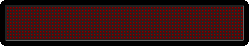

  

  

  
  
  
  
  

  

## 💁🏻 About me

- 🏗️ **Platform Architect @ IBM** — developer, consultant, strategist and IBM Trusted Advisor
- 🔭 Focused on **Hybrid Cloud, Microservices, Data Science & Blockchain**
- 👯 Always up for collaborating on **open-source projects**
- 📝 I write on [Medium](https://fawazsiddiqi.medium.com) and [dev.to](https://dev.to/fawazsiddiqi)
- 💬 Ask me anything dev related. I'm full stack 😁
- ⚡ Fun fact: I'm known to be awake at the weirdest hours 😂

## 🛠️ Tech stack

**Languages**

**Frameworks & tools**

**Cloud, DevOps & infra**

**Data & AI**

<b>…and more</b>

 

## 👾 Languages across my GitHub

{{ LANGUAGE_TEMPLATE_START:max=8 }}

{{ LANGUAGE_TEMPLATE_END }}

## 🎧 Currently listening to

  

